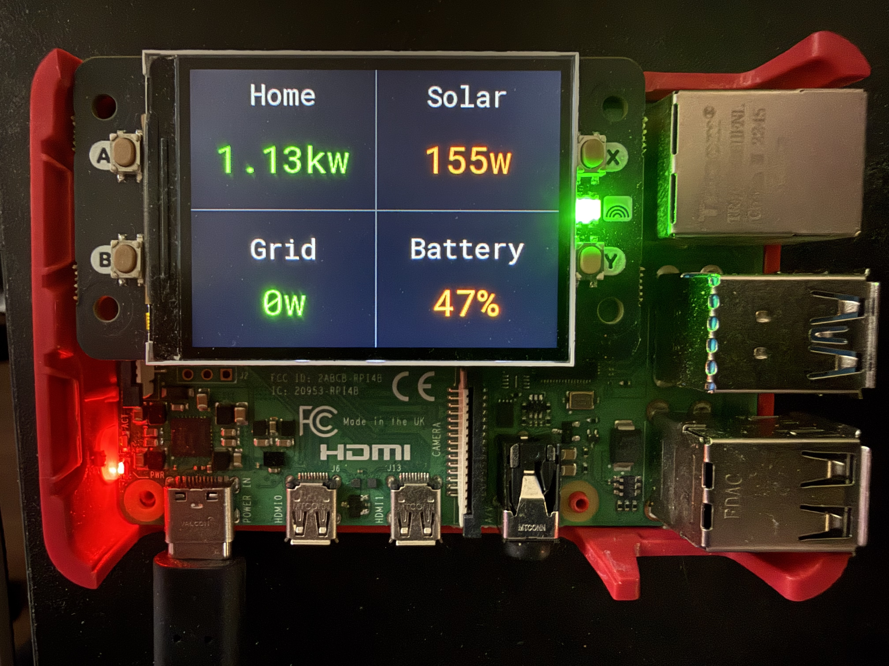

# foxcloud-pi-dashboard

## Overview 

This project provides a real-time dashboard for monitoring Foxcloud inverter and battery data on a Raspberry Pi. It displays  energy production and consumption metrics  on a small display with a LED to indicate the optimal time to use energy.



## Hardware requirements

- [Raspberry Pi Zero, or Pi Model 3, 4, 5 - this project uses model 4B](https://thepihut.com/collections/raspberry-pi-boards) 
- [Display Hat Mini](https://thepihut.com/products/display-hat-mini?variant=41128766308547)
- SD card for Raspberry Pi OS
- Power supply for Raspberry Pi
- Internet connection (for data fetching from Foxcloud)

## Software Requirements
 - Use the official [Raspberry Pi Imager](https://www.raspberrypi.com/software/) to write the OS image to the card. This project uses a lightweight Raspberry Pi 64-bit OS version without the desktop environment.
 - uv package manager for installing Python dependencies. You can install it by following the instructions in the [uv documentation](https://docs.astral.sh/uv/).


>Your Foxcloud inverter must be registered on the Foxcloud platform to access its data via the API. You can view more advanced data and analytics through via the [Foxcloud mobile app or website dashboards](https://www.fox-ess.com/products/foxcloud).

## Foxcloud Open Platform 

Foxcloud provides Open Platform for accessing solar, inverter, and battery data through its API. This allows developers to build custom applications and dashboards for monitoring energy production and consumption.

- [API docs](https://developer-eu.foxesscloud.com/apidoc)
- [Device compatibility](https://developer-eu.foxesscloud.com/deviceCompact)

## Creating an API Key

To access Foxcloud data, you need to create an API key:
1. Sign in to the [Foxcloud Developer Portal](https://developer-eu.foxesscloud.com/login).
2. Navigate to the API Keys section and create a new API key.
3. Note down the API key for use in your dashboard configuration.

>Note: Foxcloud API ingtegrations are only allowed to refresh data every 5 minutes.** If you'd like to have faster refresh rates, use the Foxcloud mobile app or website dashboards for more frequent updates.


## Installation
1. Clone the repository:
   ```bash
   git clone https://github.com/yourusername/foxcloud-pi-dashboard.git
   cd foxcloud-pi-dashboard
   ```
2. Install the required Python libraries using uv:
   ```bash
   uv sync
   ```
3. Create a `.env.json` file and add your API key and device serial number to it: 
   ```json
   {
       "API_KEY": "your_api_key_here",
       "DEVICE_SN": "your_device_serial_here"
   }
   ```
   NOTE: the `.env.json` file will be ignored by git as we don't want to commit sensitive data.
4. Run the dashboard:
   ```bash
   uv run foxcloud-pi-dashboard
   ```

## Setting up a service that will run the dashboard on startup

```bash
sudo nano /etc/systemd/system/foxcloud-pi-dashboard.service
```

# Add the following content to the file:

```ini
[Unit]
Description=Foxcloud Pi Dashboard
After=network.target

[Service]
Type=simple
User=insert_username_here
WorkingDirectory=/home/insert_username_here/dev/foxcloud-pi-dashboard
Environment="PATH=/home/insert_username_here/.local/bin:/usr/local/bin:/usr/bin"
ExecStart=/home/insert_username_here/dev/foxcloud-pi-dashboard/.venv/bin/foxcloud-pi-dashboard
Restart=on-failure
RestartSec=10

[Install]
WantedBy=multi-user.target
```
Then some setup

```bash
sudo chmod 755 /etc/systemd/system/foxcloud-pi-dashboard.service
sudo chown root:root foxcloud-pi-dashboard.service

sudo systemctl daemon-reload
sudo systemctl enable foxcloud-pi-dashboard.service
sudo systemctl start foxcloud-pi-dashboard.service
```
